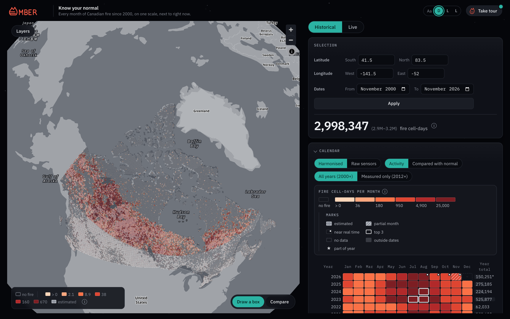

# Ember

**Ember joins 26 years of NASA MODIS and VIIRS fire detections into one comparable record for
Canada, so any season can be read against the 25 before it.**
It is a burning activity calendar for any area of the country, from November 2000 to today.

**Live app: https://6s-1.github.io/modis-viirs-fire-harmonisation/**

NASA Space Apps 2026 challenge: *Harmonization of MODIS and VIIRS Hot Spots*. Team Sitara OPS.



## The problem, and what Ember does about it

MODIS (Terra and Aqua, from 2000) has 1 km pixels; VIIRS (S-NPP from 2012, NOAA-20 from 2018) has
375 m pixels and finds **4.31x** as many fire cell-days in the same fires. Laid end to end the raw
record jumps in 2012, and every long-run question runs into that seam. Ember converts the whole
record to **VIIRS-equivalent fire cell-days** using conversion tables fitted where the two sensors
overlap, so years can be compared on one scale.

## Does it work?

Years are hidden from the model and its estimate compared with what VIIRS actually recorded
(leave-one-year-out, 2012-2025; weighted absolute error of yearly totals):

| Scale | Previous method | **Ember** |
|---|---|---|
| Canada | 8.3% | **5.7%** |
| Province | 12.4% | **8.2%** |
| Grid cell (~250 km2) | 45.2% | **36.0%** |

Across all hidden years, Canada-wide estimates land within **0.92-1.24x** the observed value. An
independent check against NBAC burned area (never a model input) shows **no step at 2012**: the
estimated years 2003-2011 track NBAC about as well as raw MODIS Aqua, the same satellite before and
after. Full method, every test and the limits: [docs/HOW-IT-WORKS.md](docs/HOW-IT-WORKS.md) and the
app's **i** panel in the header.

## Run it

```bash
cd web && npm install && npm run dev      # http://localhost:5173
```

That is enough to run the app: the harmonised export is committed in `web/public/harmonised/`.
Rebuilding it from raw FIRMS downloads is under [Reproduce](#reproduce). Live mode additionally
needs the Cloudflare Worker in `worker/` with a FIRMS key; without it the historical record still
works.

## Data credits in brief

NASA FIRMS (MODIS Collection 6.1 and VIIRS 375 m Collection 2) for every fire detection; ESA
WorldCover for land cover; NBAC, NFDB and CWFIS (Natural Resources Canada) for burned area, fire
causes and agency-reported fires; WorldPop for population; GeoNames and Natural Earth for places and
boundaries. Full list with links: [Data and tools](#data-and-tools), with the
providers' [attribution statements](#attribution-and-licences). Ember was built with the help
of an AI coding assistant under my direction; see [Use of AI tools](#use-of-ai-tools).

## What you can do in the app

- Draw a box on the globe or type bounds, pick a date range.
- The box fills with grid cells coloured by fire activity; the calendar shows years by months.
- Compare the latest months with the historical median; switch between harmonised and raw sensor counts.
- Download monthly values per cell (CSV), the raw hotspots in the box (CSV), the calendar (PNG) or, in live mode,
  the live hotspots (CSV). File names give the area (`canada` or the box bounds) and the period; each CSV starts
  with `#` lines for the area, period, data end, generation time (UTC) and units (`pandas.read_csv(f, comment="#")`).
- Click a grid cell to see that cell alone; see recent near-real-time hotspots; see people living in the area
  and a list of areas with fire ranked by people exposed (exposure only, not a priority list).

## Method in short

1. **Clean** FIRMS detections: presumed vegetation fire only (type 0), low-confidence class removed
   (MODIS confidence < 30, VIIRS `l`). Day and night, and each satellite, kept apart.
2. **Fire cell-days**: detections on an H3 resolution 8 grid (~0.74 km²); a cell counts once per
   satellite per local solar day. Monthly totals on H3 resolution 5 (~250 km²), near equal-area across Canada.
3. **VIIRS reference** from 2012: mean of S-NPP and NOAA-20 where both are available, outage days masked.
4. **Conversion tables** fitted on 2012–2025: VIIRS cell-days per MODIS cell-day by ecozone x land cover
   (ESA WorldCover, 4 classes) x season x fire-intensity tercile (mean FRP per detection), with fallback
   to broader groups for thin strata.
   - Aug 2002 onward: MODIS input = cell-days seen by Aqua **or** Terra.
   - Nov 2000 – Jul 2002 (Terra only): a Terra-only table of the same form.
   - The original VIIRS/Aqua table is kept as the fallback.
5. **Validation** by hiding years: fit on 2019–2025 and predict 2012–2014, and leave-one-year-out over
   2012–2025. These errors set the likely ranges shown for estimated years, scaled by area.
6. **Independent check** against NBAC burned area (not a model input).

Every number in the app is read from files the pipeline writes.

## Repository layout

```
pipeline/            Python pipeline (run in the order below)
reports/             small outputs kept in git: filter report, calibration tables, metrics, figures
web/                 Vite + MapLibre app; web/public/harmonised/ is the static export it loads
.github/workflows/   GitHub Pages deploy
data/                all raw, intermediate and processed data (not in git)
```

## Reproduce

Requirements: Python 3.12, Node 22, about 3 GB free disk, internet access (land cover is read from
ESA WorldCover's public cloud bucket).

```bash
python -m venv .venv && .venv/bin/pip install -r requirements.txt
```

### 1. Get the data (not in git)

| Data | Where | Put it in |
|---|---|---|
| FIRMS yearly country summaries: `modis_<year>_all_countries.zip` (2000–2025), `viirs-snpp_<year>_all_countries.zip` (2012–2025), `viirs-jpss1_<year>_all_countries.zip` (2018–2025) | https://firms.modaps.eosdis.nasa.gov/country/ | `data/zips/` |
| FIRMS archive download for Canada for the current year (M-C61, SV-C2, J1V-C2; archive and NRT CSVs) | https://firms.modaps.eosdis.nasa.gov/download/ | `data/raw/modis/2026/`, `data/raw/viirs-snpp/2026/`, `data/raw/viirs-noaa20/2026/` |
| Terrestrial ecozones of Canada | https://sis.agr.gc.ca/cansis/nsdb/ecostrat/zone/ecozone_shp.zip | unzip to `data/external/ecozones/` |
| Natural Earth admin-1, 1:50m | https://naciscdn.org/naturalearth/50m/cultural/ne_50m_admin_1_states_provinces.zip | unzip to `data/external/ne_admin1/` |
| NBAC per-year zips 2000–2025 (for the check and experiments) | https://cwfis.cfs.nrcan.gc.ca/downloads/nbac/ | `data/external/nbac/` |
| NFDB fire points, text (experiments only) | https://cwfis.cfs.nrcan.gc.ca/downloads/nfdb/fire_pnt/current_version/ | unzip to `data/external/nfdb/txt/` |
| WorldPop 2020 1 km UN-adjusted population, Canada (`can_ppp_2020_1km_Aggregated_UNadj.tif`) | https://data.worldpop.org/GIS/Population/Global_2000_2020_1km_UNadj/2020/CAN/ | `data/external/worldpop/` |
| GeoNames `cities500.zip` (place names) | https://download.geonames.org/export/dump/ | `data/external/geonames/` |

### 2. Run the pipeline

```bash
P=".venv/bin/python pipeline"
$P/extract_country.py --country Canada   # Canada CSV from each zip -> data/raw/<sensor>/ (verified zips in data/zips are deleted)
$P/inspect_raw.py                        # optional: columns, dtypes, row counts
$P/clean.py                              # filters -> data/interim/detections/, reports/filter_report.json
$P/cell_days.py                          # fire cell-days, coverage, monthly totals
$P/landcover.py                          # ESA WorldCover class per fire cell
$P/regions.py                            # ecozone and province per display cell
$P/calibrate.py                          # VIIRS reference, original ratio table, validation, month sources
$P/experiments.py                        # variant comparison (stage A); also builds the base the adopted model uses
$P/nbac_link.py                          # link fire cells to NBAC fires (needs NBAC)
$P/experiments_b.py                      # stage B variants + reports/experiments/comparison_all.csv (needs NBAC, NFDB)
$P/harmonise.py                          # apply the adopted model -> data/processed/harmonised_cell_month.parquet
$P/figures.py                            # reports/figures/canada_annual_series.png
$P/nbac_check.py                         # independent check -> reports/nbac_check/, reports/figures/nbac_check.png
$P/population.py                         # WorldPop people per cell and in fire cells, GeoNames places
$P/export.py                             # static files for the app -> web/public/harmonised/
$P/hotspot_tiles.py                      # hotspot tiles -> web/public/hotspots/ (not in git)
$P/about_data.py                         # numbers and figures for the app -> web/public/about/
```

New data (for example the next year's archive files) are picked up by rerunning from `clean.py`.
The conversion tables stay fitted on 2012–2025 unless `TRAIN_ALL` in `pipeline/calibrate.py` is changed.

### 3. Run the app

```bash
cd web
npm ci
npm run dev        # http://localhost:5173/
npm run build      # static site in web/dist/
```

The app is fully static. The hotspot download reads `web/public/hotspots/`; without it, that button is hidden.

### 4. Live fire Worker (optional)

The live fire layer reads NASA FIRMS near-real-time data through a small Cloudflare Worker in `worker/`,
which keeps the FIRMS map key as a secret. Without it the app hides that layer and everything else works.

```bash
cd worker
npm ci
npx wrangler login
npx wrangler deploy                       # prints the Worker address
npx wrangler secret put FIRMS_MAP_KEY     # paste the key when asked
gh variable set LIVE_URL --body "https://ember-live-proxy.<your-subdomain>.workers.dev"
```

For local testing put `FIRMS_MAP_KEY=...` in `worker/.dev.vars` (not committed), run `npx wrangler dev`,
and start the app with `VITE_LIVE_URL=http://127.0.0.1:8787 npm run dev`.

To point the dev server at the deployed Worker instead, write the address to `web/.env.local`
(not committed) and restart the dev server:

```bash
printf 'VITE_LIVE_URL=%s\n' "$(gh variable get LIVE_URL)" > web/.env.local
```

Without it, live mode shows "Live fire data is unavailable right now." and the dev console says why.
The dev server uses `strictPort`, because the Worker only allows requests from `:5173` and `:4173`;
on another port it would refuse them.

### 5. Deploy

Pushing to `main` builds and deploys to GitHub Pages (`.github/workflows/deploy.yml`). The hotspot
tiles are too large for git, so they are published as an asset on the `hotspot-tiles` release and
added at build time:

```bash
tar -cf hotspots.tar -C web/public hotspots
gh release upload hotspot-tiles hotspots.tar --clobber
```

## Data and tools

Everything Ember uses, with the page or endpoint it is actually taken from.

### NASA data

| What | Used for | Link |
|---|---|---|
| FIRMS archive download (MODIS Collection 6.1, VIIRS 375 m Collection 2) | Every fire detection in the harmonised record, 2000 to present | https://firms.modaps.eosdis.nasa.gov/download/ |
| FIRMS area API (`/api/area/csv/`) | Near-real-time hotspots in live mode, fetched server-side by the Worker | https://firms.modaps.eosdis.nasa.gov/api/area/ |
| FIRMS | The service itself, part of NASA's Earth Science Data and Information System (ESDIS) | https://firms.modaps.eosdis.nasa.gov/ |
| NASA Earthdata: FIRMS | Product documentation and access | https://www.earthdata.nasa.gov/data/tools/firms |

Instruments behind those detections: MODIS on Terra and Aqua, VIIRS on Suomi-NPP, NOAA-20 and
NOAA-21.

### Space agency partner data

| What | Used for | Link |
|---|---|---|
| ESA WorldCover 10 m 2021 v200 | Land cover class (forest, grass and shrub, cropland, other) in the conversion tables; read directly from the public bucket | https://esa-worldcover.org/en |
| ESA WorldCover v200 release | The dataset record and citation | https://zenodo.org/records/7254221 |

### Other data

| What | Used for | Link |
|---|---|---|
| National Burned Area Composite (NBAC), Canadian Forest Service | Independent check against burned area, and fire size and name in the *Why it burned* card | https://cwfis.cfs.nrcan.gc.ca/downloads/nbac/ |
| Canadian National Fire Database (NFDB), fire points | Recorded cause of fires in the *Why it burned* card | https://cwfis.cfs.nrcan.gc.ca/downloads/nfdb/fire_pnt/current_version/ |
| CWFIS Active Fires, from provincial, territorial and Parks Canada agencies | Agency-reported fires near a cell in live mode: name, size, stage of control | https://cwfis.cfs.nrcan.gc.ca/datamart |
| Terrestrial Ecozones of Canada, Agriculture and Agri-Food Canada | The 15 fire regions the conversion tables are fitted per | https://sis.agr.gc.ca/cansis/nsdb/ecostrat/zone/ecozone_shp.zip |
| WorldPop 2020 1 km UN-adjusted, Canada | People living in an area, and the exposure list | https://data.worldpop.org/GIS/Population/Global_2000_2020_1km_UNadj/2020/CAN/ |
| WorldPop | The project itself | https://www.worldpop.org/ |
| GeoNames `cities500` | Place names on the globe | https://download.geonames.org/export/dump/ |
| Natural Earth 1:50 m admin 1 states and provinces | Canada and province boundaries; clipping detections to Canada | https://naciscdn.org/naturalearth/50m/cultural/ne_50m_admin_1_states_provinces.zip |
| Natural Earth | The project itself | https://www.naturalearthdata.com/ |
| OpenFreeMap (positron style), © OpenMapTiles, data © OpenStreetMap contributors | The base map | https://openfreemap.org/ |

NBAC, NFDB, CWFIS and the ecozones contain information licensed under the
[Open Government Licence – Canada](https://open.canada.ca/en/open-government-licence-canada).

### Tools

| What | Used for | Link |
|---|---|---|
| MapLibre GL JS | The globe and every map layer | https://maplibre.org/maplibre-gl-js/docs/ |
| H3 (`h3-js` in the app, `h3-py` in the pipeline) | The hexagon grids: resolution 8 for detection, 5 for display | https://h3geo.org/ |
| Vite | Build and dev server for the web app | https://vite.dev/ |
| Cloudflare Workers | The proxy that keeps the FIRMS key off the client | https://developers.cloudflare.com/workers/ |
| GitHub Pages | Hosting the live app | https://pages.github.com/ |
| pandas | Every table in the pipeline | https://pandas.pydata.org/ |
| NumPy | The numeric work behind the conversion tables | https://numpy.org/ |
| GeoPandas | Ecozone, boundary and NBAC geometry | https://geopandas.org/ |
| Rasterio | Reading the WorldCover and WorldPop rasters | https://rasterio.readthedocs.io/ |
| SciPy | Statistics for the validation tests | https://scipy.org/ |
| Matplotlib | The validation figures in docs/ | https://matplotlib.org/ |
| Claude (Anthropic) | AI coding assistant, used as described under [Use of AI tools](#use-of-ai-tools) | https://claude.com/product/claude-code |

## Limits

- Extreme northern fire years are underestimated (2014: about −19% for all of Canada when hidden).
- 2001 and 2002 are low against NBAC burned area; raw Terra shows the same gap.
- Small areas are uncertain; estimated years are labelled low confidence below 10,000 km² of Canada in the box.
- Detected fire is a floor, not a full count of fires.
- The latest months (August–November 2026) use provisional near-real-time data.
- Canada only in this version.

## Use of AI tools

Ember was built with the help of an AI coding assistant (Claude), under my direction, for writing
and debugging code, running data checks and drafting text. The method, the data choices, the design
and every final decision are mine. The logo and the mascot are my own drawings, converted to SVG
with AI help.

## Attribution and licences

The links and uses are in [Data and tools](#data-and-tools); these are the attribution statements
each provider asks for.

- NASA FIRMS active fire data (MODIS Collection 6.1, VIIRS 375 m), NASA ESDIS.
- NBAC and Canadian National Fire Database, Canadian Forest Service, Natural Resources Canada (CWFIS), and the
  Terrestrial Ecozones of Canada, Agriculture and Agri-Food Canada: contain information licensed under the
  [Open Government Licence – Canada](https://open.canada.ca/en/open-government-licence-canada).
- © ESA WorldCover project 2021 / Contains modified Copernicus Sentinel data (2021) processed by the ESA WorldCover consortium (CC BY 4.0).
- Natural Earth (public domain). Base map: OpenFreeMap, © OpenMapTiles, data © OpenStreetMap contributors.
- Population: WorldPop 2020 (CC BY 4.0), a modelled estimate. Place names: GeoNames (CC BY 4.0).

References are listed in [docs/HOW-IT-WORKS.md](docs/HOW-IT-WORKS.md).
